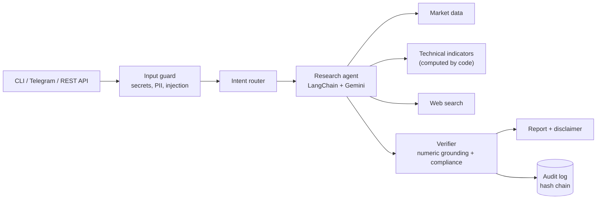

# AlphaMacro-Crypto

[](https://github.com/YOUR_USERNAME/alphamacro-crypto/actions/workflows/ci.yml)


**Verifiable AI research for macroeconomics and crypto.** Instead of trusting an LLM's numbers,
the system computes indicators in code, checks every figure in the report against tool output,
blocks secrets before they leave your machine, and writes a tamper-evident audit trail.
Available as a CLI, a Telegram bot and a REST API.

> **Ringkasan (Bahasa Indonesia):** Agent riset makro & kripto yang *dapat diverifikasi*:
> indikator teknikal dihitung oleh kode (bukan LLM), setiap angka di laporan dicocokkan dengan
> data tool, kunci rahasia diblokir sebelum dikirim ke penyedia AI, dan semua permintaan dicatat
> dalam audit log anti-manipulasi. Tersedia sebagai CLI, bot Telegram, dan REST API.

## What makes it different

| Capability | How it works |
|---|---|
| **Numeric grounding** | Each number in the report is matched to raw tool output (rounding-aware, handles `1,234.5` and `1.234,5`). Report shows "13 of 15 numbers verified" and lists the rest. |
| **Computed indicators** | RSI, MACD, SMA/EMA, Bollinger, ATR, swing support/resistance, volatility and drawdown from real price data. RSI is tested against a published reference. |
| **Input guard** | Blocks API keys, private keys and seed phrases; redacts emails, phones, cards; flags prompt injection. Blocked secrets are never hashed, stored or sent. |
| **Output compliance flags** | Flags guarantee language, personal buy/sell orders and price targets. |
| **Audit trail** | Hash-chained JSONL; users pseudonymised; query text not stored by default; `alphamacro-audit verify`. |
| **Source honesty** | Sources and tools listed in the report come from the real tool trace, not from the model. |

## Architecture



## Quick start

Requires Python 3.10+, a [Google AI Studio](https://aistudio.google.com/) key and a
[Tavily](https://tavily.com/) key (plus a Telegram token for the bot).

```bash
git clone https://github.com/YOUR_USERNAME/alphamacro-crypto.git && cd alphamacro-crypto
python -m venv venv && source venv/bin/activate     # Windows: venv\Scripts\activate
pip install -e ".[api]"
cp .env.example .env                                 # fill in your keys (never commit .env)

alphamacro "Dampak CPI terhadap Bitcoin minggu ini?"
alphamacro "Analisa teknikal BTC: RSI dan MACD"
alphamacro-bot                                       # Telegram bot
```

## REST API

```bash
alphamacro-keygen acme-research          # prints a key ONCE + the hash to put in .env
# .env: API_KEY_HASHES=acme-research:<hash>
alphamacro-api                           # http://127.0.0.1:8000  (docs at /docs)

curl -X POST http://127.0.0.1:8000/v1/analyze \
  -H "X-API-Key: amc_..." -H "Content-Type: application/json" \
  -d '{"query": "Analisa teknikal Bitcoin"}'

curl -H "X-API-Key: amc_..." "http://127.0.0.1:8000/v1/indicators/bitcoin?timeframe=daily"
```

`/v1/indicators/{coin}` is deterministic and uses no LLM: cheap, fast and fully reproducible.
Responses include `grounding`, `compliance_flags`, `warnings`, `sources` and a `request_id`
(also returned as `X-Request-ID`). The server refuses to start without configured keys, binds to
localhost by default, and returns generic errors (no internals).

## Audit log

```bash
# .env: AUDIT_LOG_PATH=audit/audit.jsonl and AUDIT_SALT=<random secret>
alphamacro-audit verify audit/audit.jsonl
# OK: 128 records. Head hash (anchor this): 9f2c...
```

Editing or deleting a record in the middle breaks verification. To also detect truncation of the
end of the file, record the printed head hash somewhere external on a schedule.

## Configuration

Everything is configured through environment variables; see [`.env.example`](.env.example).
Key groups: providers (`GOOGLE_API_KEY`, `TAVILY_API_KEY`, `COINGECKO_API_KEY`), bot
(`TELEGRAM_TOKEN`, `TELEGRAM_ALLOWED_USER_IDS`, rate limits), verification
(`GROUNDING_MIN_SCORE`), audit (`AUDIT_LOG_PATH`, `AUDIT_SALT`), API (`API_KEY_HASHES`, limits) and
logging (`LOG_LEVEL`, `LOG_FORMAT=json`).

## Docker

```bash
docker compose up -d --build        # services: bot, api (api published on localhost only)
```

## Development

```bash
pip install -e ".[dev]"
ruff check . && ruff format --check . && mypy src && pytest --cov=alphamacro
```

Tests run offline with injected fakes. See [CONTRIBUTING.md](CONTRIBUTING.md).

## Limitations

- Numeric grounding is a heuristic: it proves a number *appears* in tool data, not that it is used
  correctly. Guardrails are pattern-based.
- Macro analysis currently depends on web search rather than primary data APIs.
- Rate limits and cache are in-process (use a shared store before running many replicas).
- Live CoinGecko/Tavily/Gemini behaviour is not covered by the offline test suite.

For what a regulated buyer would still require, read
[docs/ENTERPRISE_READINESS.md](docs/ENTERPRISE_READINESS.md).

## Disclaimer

Output is AI-generated, informational and educational only. It is **not** financial, investment or
legal advice. Crypto assets are highly volatile and risky.

## License

[MIT](LICENSE)
