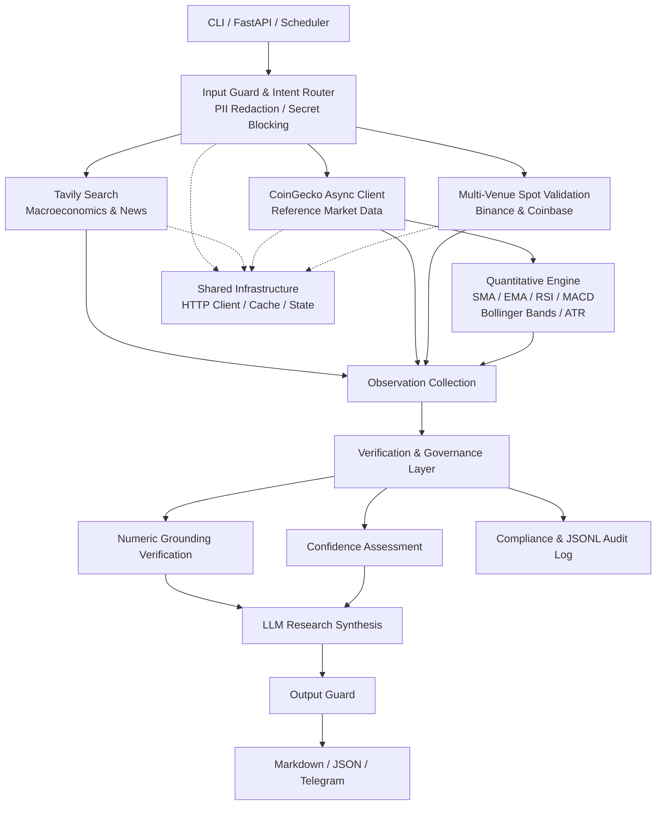

# AlphaMacro-Crypto

**Verifiable AI Macroeconomics & Cryptocurrency Research Engine**

AlphaMacro-Crypto is an AI-powered macroeconomic and cryptocurrency research engine designed to produce data-grounded, auditable, and verifiable market analysis.

The system separates deterministic quantitative computation from LLM-based (Large Language Model) synthesis. Technical indicators, multi-venue spot price validation, numeric grounding checks, and confidence assessments are computed by auditable Python code rather than generated or estimated by the language model.

The LLM is responsible for interpreting verified observations and synthesizing research outputs. It does not independently calculate technical indicators or invent market data.

## Core Principles

- **Deterministic Computation:** Quantitative indicators are calculated using explicit mathematical functions.
- **Data Provenance:** Every external observation records its source, fetch timestamp, and freshness status.
- **Numeric Grounding:** Reported numerical values are checked against the underlying observations and calculated metrics.
- **Multi-Venue Validation:** Cryptocurrency reference prices are compared against independent exchange spot quotes.
- **Resilient Data Access:** Asynchronous requests, caching, bounded retries, and fallback mechanisms improve reliability.
- **Auditable Execution:** Structured observations, verification results, and compliance events are recorded for inspection.

## Architecture Overview

The system follows a modular pipeline that separates external data acquisition, quantitative analysis, verification, and output generation.



### Data Flow

1. The CLI, FastAPI application, or scheduler receives a request.
2. The input guard validates the request, redacts personally identifiable information (PII), and blocks prohibited secrets.
3. Data acquisition tools collect macroeconomic information, cryptocurrency market data, and exchange spot quotes.
4. The quantitative engine calculates technical indicators from available market observations.
5. The verification layer checks data provenance, numerical grounding, and confidence assessments.
6. The LLM synthesizes the verified observations into a structured research response.
7. The output guard applies compliance checks before delivering the result.

The quantitative engine and verification layer are implemented independently of LLM-generated calculations.

## Key Capabilities

### M1 — Async-First Infrastructure & Resilient Caching

The infrastructure layer provides non-blocking data access and resilient request handling.

- Asynchronous HTTP clients using `httpx`.
- Bounded retries with exponential backoff and jitter.
- `CachingFeed` with stale-while-revalidate and stale-if-error strategies.
- Single-flight request coalescing to reduce duplicate concurrent requests.
- Pluggable state backends:
  - In-memory storage.
  - SQLite with Write-Ahead Logging (WAL).
  - Redis.

The caching layer is designed to reduce unnecessary external requests while preserving access to previously collected data when upstream services are temporarily unavailable.

### M2 — Deterministic Quantitative Engine

The quantitative engine implements technical and statistical indicators using pure Python mathematical functions.

| Indicator | Configuration |
|---|---|
| Simple Moving Average (SMA) | 20, 50, 200 periods |
| Exponential Moving Average (EMA) | 12, 26 periods |
| Relative Strength Index (RSI) | 14 periods, Wilder smoothing |
| Moving Average Convergence Divergence (MACD) | 12, 26, 9 |
| Bollinger Bands | Configurable period and standard deviation |
| Average True Range (ATR) | 14 periods |
| Swing Support & Resistance | Swing-based price levels |
| Annualized Realized Volatility | Historical return-based volatility |
| Maximum Drawdown | Peak-to-trough portfolio or price decline |

The engine produces a deterministic technical snapshot from the available market data.

The same input observations and calculation parameters produce the same indicator values, subject to the implementation's numerical precision.

### M3a — Data Provenance & Anti-Hallucination Controls

The verification layer establishes a traceable relationship between collected observations and the final research output.

**Observation Provenance**

Each tool call produces a structured `Observation` artifact containing:

- Data source and observation metadata.
- Fetch timestamp.
- Data freshness status.
- Retrieved values and associated metrics.

**Numeric Grounding**

The `GroundingReport` checks numerical claims in the generated report against the underlying observations and calculated metrics.

**Confidence Assessment**

The `ConfidenceReport` evaluates the reliability of the available evidence and assigns one of three confidence levels:

- `HIGH`
- `MEDIUM`
- `LOW`

Confidence assessments are generated by deterministic verification logic rather than being assigned solely by the LLM.

**Auditability**

Compliance events and structured verification records are written to JSONL audit logs for subsequent inspection.

### M3b — Multi-Venue Spot Price Cross-Validation

AlphaMacro-Crypto validates CoinGecko reference prices against spot quotes retrieved from Binance and Coinbase.

The validation process:

1. Retrieves the reference market price from CoinGecko.
2. Concurrently retrieves available spot quotes from supported exchanges.
3. Calculates the observed price divergence between venues.
4. Evaluates the divergence against configured validation thresholds.
5. Records the results and flags abnormal price discrepancies.

This process helps identify inconsistent market observations and potential venue-specific price anomalies.

Cross-validation does not guarantee that every exchange quote is executable or that all market prices are identical.

### M4 — Alert & Digest Scheduler

The scheduler evaluates configured conditions and delivers notifications through the Telegram Bot API.

**Supported alert conditions include:**

| Condition | Description |
|---|---|
| `price_gt` | Price exceeds a configured threshold |
| `price_lt` | Price falls below a configured threshold |
| `change_24h_gt` | 24-hour price change exceeds a threshold |
| `rsi_gt` | RSI exceeds a configured threshold |
| `spread_gt` | Price spread exceeds a configured threshold |

**Scheduling and delivery features:**

- Periodic market digest generation.
- Distributed lease locks to coordinate scheduler execution.
- Cooldown suppression to reduce repetitive notifications.
- Chunked Telegram message delivery for long reports.
- Asynchronous notification handling.

The scheduler evaluates configured conditions against available observations and calculated metrics.

## Technology Stack

| Component | Technology |
|---|---|
| Language | Python |
| API Framework | FastAPI |
| HTTP Client | httpx |
| Data Validation | Pydantic |
| Quantitative Computation | Pure Python |
| Market Data | CoinGecko |
| Exchange Spot Data | Binance, Coinbase |
| Macroeconomic Research | Tavily Search |
| State Storage | Memory, SQLite, Redis |
| Database Journaling | SQLite WAL |
| Notification Delivery | Telegram Bot API |
| Output Formats | Markdown, JSON |
| Background Scheduling | Asyncio |

## Project Structure

```text
src/alphamacro/
├── api/
│   ├── app.py              # FastAPI routes and application setup
│   ├── auth.py             # API key verification
│   └── main.py             # Production ASGI entrypoint
│
├── delivery/
│   └── telegram.py         # Async Telegram delivery and message chunking
│
├── infra/
│   ├── caching.py          # CachingFeed and caching strategies
│   ├── http.py             # Shared HTTP client and bounded retry helper
│   ├── sync_bridge.py      # Thread-safe background asyncio LoopThread
│   └── state/
│       ├── ...             # Memory, SQLite WAL, and Redis adapters
│
├── quant/
│   ├── indicators.py       # Pure mathematical indicator functions
│   └── snapshot.py         # Deterministic technical snapshot builder
│
├── tools/
│   ├── coingecko.py        # Async/sync CoinGecko clients and observations
│   ├── technical.py        # Technical indicator LangChain tools
│   └── venues.py           # Binance/Coinbase spot cross-validation
│
├── cli.py                  # Interactive and one-shot CLI
├── compliance.py           # Secret blocking, PII redaction, output guard
├── config.py               # Validated environment settings
├── engine.py               # Main research orchestration pipeline
├── grounding.py            # Numeric grounding and confidence scoring
├── models.py               # Immutable Pydantic domain models
├── scheduler.py            # Alert evaluator and periodic digest scheduler
└── worker.py               # Standalone background scheduler entrypoint
```

## Local Quickstart

### Prerequisites

- Python compatible with the project's dependency configuration.
- Git.
- API credentials for Google and Tavily.
- Access to the required external market data services.

Docker is not required for local CLI development.

### 1. Create a Virtual Environment

Create and activate a Python virtual environment:

**Windows PowerShell**

```powershell
python -m venv .venv
.\.venv\Scripts\Activate.ps1
```

**Linux / macOS**

```bash
python -m venv .venv
source .venv/bin/activate
```

### 2. Install Dependencies

Install the project and development dependencies:

```bash
python -m pip install --upgrade pip
pip install -e ".[dev]"
```

### 3. Configure Environment Variables

Create the local environment configuration file:

**Windows PowerShell**

```powershell
Copy-Item .env.example .env
```

**Linux / macOS**

```bash
cp .env.example .env
```

Edit `.env` and configure the required credentials:

```dotenv
GOOGLE_API_KEY=your_google_api_key
TAVILY_API_KEY=your_tavily_api_key
```

Additional configuration may be required depending on the selected storage backend, API authentication settings, and notification features.

Never commit `.env` or expose API credentials in source code.

### 4. Run the CLI

**Single query**

```bash
python -m alphamacro.cli "Analisis teknikal Bitcoin timeframe daily dan sentimen makro Fed"
```

**JSON output**

```bash
python -m alphamacro.cli --json "Cek harga Ethereum dan spread multi-venue"
```

**Interactive mode**

```bash
python -m alphamacro.cli
```

## Docker Compose Deployment

### API + Redis + Scheduler

Docker Compose runs the API service, Redis-backed shared state, and the background scheduler.

The shared Redis state supports caching, rate limiting, and distributed scheduler locks.

### 1. Configure Environment Variables

Create the environment file:

```bash
cp .env.example .env
```

Configure the required credentials and security settings:

```dotenv
GOOGLE_API_KEY=your_google_api_key
TAVILY_API_KEY=your_tavily_api_key
API_KEY_HASHES=your_sha256_api_key_hash
```

Configure `TELEGRAM_BOT_TOKEN` if Telegram delivery is enabled.

For production deployment, use strong API keys and keep all credentials outside version control.

### 2. Build and Start Services

```bash
docker compose up -d --build
```

### 3. Verify Running Containers

```bash
docker compose ps
```

Check the API health endpoint:

```bash
curl http://localhost:8000/healthz
```

The expected response should indicate that the API process is running.

### 4. Stop Services

```bash
docker compose down
```

To remove persistent Docker volumes as well, use:

```bash
docker compose down -v
```

**Warning:** Removing volumes may permanently delete stored Redis or other persistent service data. Use this command only when that data is no longer needed.

## REST API Reference

The API is served by FastAPI.

All `/v1/*` endpoints require the `X-API-Key` header matching a SHA-256 digest configured in `API_KEY_HASHES`.

Health endpoints are available without API authentication, subject to the application's configuration.

| Method | Endpoint | Description |
|---|---|---|
| `GET` | `/healthz` | Liveness probe |
| `GET` | `/readyz` | Readiness probe and active version |
| `POST` | `/v1/analyze` | Full AI research run with grounding, cross-validation, and confidence report |
| `GET` | `/v1/indicators/{coin_id}` | Deterministic technical indicators; supports `?timeframe=daily` or `4h` |
| `GET` | `/v1/alerts` | List configured price, RSI, and spread alert rules |
| `POST` | `/v1/alerts` | Create or update an alert rule |
| `DELETE` | `/v1/alerts/{rule_id}` | Delete an alert rule |
| `POST` | `/v1/alerts/check` | Trigger an immediate alert evaluation cycle |

### Example Request — Analyze Market Conditions

```bash
curl -X POST http://localhost:8000/v1/analyze \
  -H "Content-Type: application/json" \
  -H "X-API-Key: your-plain-api-key" \
  -d '{"query": "Bagaimana kondisi harga Bitcoin dan sinyal RSI daily saat ini?"}'
```

The `X-API-Key` value is the plain API key issued to the client. The server verifies it against the configured SHA-256 digest.

### Example Request — Retrieve Technical Indicators

```bash
curl -X GET "http://localhost:8000/v1/indicators/bitcoin?timeframe=daily" \
  -H "X-API-Key: your-plain-api-key"
```

The indicators endpoint returns deterministic quantitative results without invoking the LLM.

### API Documentation

When the FastAPI application is running, interactive API documentation is typically available at:

- Swagger UI: `http://localhost:8000/docs`
- OpenAPI schema: `http://localhost:8000/openapi.json`

These routes depend on the application's FastAPI documentation configuration.

## Testing & Linting

Run the following commands from the project root.

### Run the Test Suite

```bash
python -m pytest -v
```

### Run Ruff Linter

```bash
ruff check src tests
```

### Automatically Fix Supported Lint Issues

```bash
ruff check --fix src tests
```

### Format the Code

```bash
ruff format src tests
```

Run the test suite again after applying automatic fixes or formatting.

## Verification & Release Workflow

Before pushing changes to GitHub, run the following checks in Windows PowerShell:

```powershell
ruff check --fix src tests
python -m pytest -v
git status
```

Review the test results and inspect the changes before committing.

### Commit Changes

```powershell
git add -A
git commit -m "docs(deploy): add production Docker Compose, worker entrypoint, .env.example, and README"
```

### Create a Version Tag

```powershell
git tag -a v1.0.0 -m "Production-ready release M1-M4"
```

### Push Changes and Tag

```powershell
git push origin main
git push origin v1.0.0
```

Replace `main` if the repository uses a different default branch.

The `v1.0.0` tag should only be created after the documented features have been implemented and verified. A successful lint or test run alone does not establish that the entire system is production-ready.

## Project Status

AlphaMacro-Crypto is organized into four major development modules:

- **M1:** Asynchronous infrastructure and resilient caching.
- **M2:** Deterministic quantitative computation.
- **M3a / M3b:** Verification, provenance, and multi-venue validation.
- **M4:** Alerting, scheduling, and Telegram delivery.

The architecture and module descriptions document the intended system capabilities. Actual implementation status should be verified against the current source code and test results.

## Research Integrity

AlphaMacro-Crypto is designed to make its research outputs traceable to collected evidence.

The system distinguishes between:

- **Observed Data:** Values retrieved from external sources.
- **Calculated Metrics:** Values produced by deterministic Python functions.
- **Verified Claims:** Numerical statements checked against observations and calculated metrics.
- **LLM Synthesis:** Interpretations and explanations generated from the verified evidence.

The presence of a verification layer does not guarantee that external data is accurate, that every generated statement is correct, or that future market movements can be predicted reliably.

## Security Considerations

- Never commit `.env` files, API keys, or other credentials.
- Use strong API keys and store their SHA-256 digests in the server configuration.
- Avoid exposing API keys in shell history, screenshots, logs, or public repositories.
- Restrict access to production API endpoints.
- Keep dependencies updated and review security advisories.
- Use HTTPS when exposing the API outside a trusted local network.
- Configure Redis access controls and network restrictions before production deployment.
- Review audit logs to ensure sensitive information is not being recorded.

## Disclaimer

AlphaMacro-Crypto is an informational market research and data-aggregation tool. Its outputs do not constitute financial, investment, or trading advice.

Market data may be delayed, incomplete, inconsistent, or unavailable. Technical indicators and confidence assessments are analytical tools, not guarantees of future market behavior.

Users should independently verify critical information and evaluate the risks associated with any financial decision.
